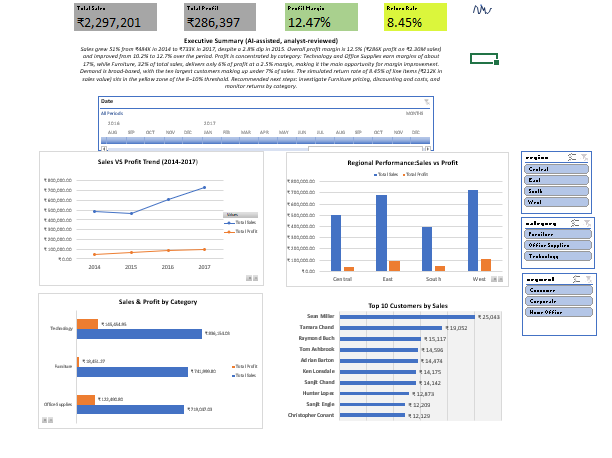

# Retail Sales Analytics Dashboard

An end-to-end analytics project: raw retail transactions are loaded into a normalized **MySQL** database, pulled into **Excel** with **Power Query**, modelled in **Power Pivot** with **DAX**, and presented as an interactive dashboard.



## Business problem

A retailer wants a single, filterable view of how the business is performing:

- How are sales and profit trending over time?
- Which product categories and regions drive revenue, and which ones actually earn profit?
- Who are the biggest customers, and how dependent is the business on them?
- What share of sales is affected by returns?

## Tech stack

| Layer | Tool | Used for |
|---|---|---|
| Storage and analysis | MySQL 8.4, MySQL Workbench | Normalized schema, view, window functions, stored procedures |
| ETL | Excel Power Query | Live connection to MySQL, type checks, date table |
| Data model | Excel Power Pivot | Relationships, hierarchies, DAX measures |
| Presentation | Excel PivotCharts, slicers, timeline | Interactive dashboard |
| Reporting | AI-assisted summary (reviewed and edited by the analyst) | Executive summary on the dashboard |

## Architecture


## Dataset

- **Source:** Sample Superstore (the widely used Tableau sample retail dataset, available on Kaggle)
- **Size:** 9,994 order lines, 21 columns, orders from 2014 to 2017
- **Note on currency:** the source data is US retail data and is not currency-converted. The dashboard shows amounts with a ₹ format for presentation only.

The CSV is not included in this repository. Download it from Kaggle and place it where the import script expects it.

## Database design

```
customers (794)            orders (9,994)                returns (450, simulated)
-----------------          ----------------------        ------------------------
customer_id  PK  <------   customer_id  FK               order_id  PK
customer_name              row_id       PK               returned
segment                    order_id (repeats)
country                    order_date, ship_date
                           city, state, postal_code, region
                           category, sub_category, product_name
                           sales, quantity, discount, profit
```

`vw_orders_enriched` joins all three tables and adds an `is_returned` flag. Power Query reads this single view.

### Design decisions

- **Location lives on orders, not customers.** City, state, postal code and region differ between orders for the same customer ID, because they describe the shipping address. Putting them on `customers` caused duplicate primary key errors, so they were moved to `orders`.
- **No foreign key from returns to orders.** `orders.order_id` repeats by design (one order can hold several products), and MySQL only allows foreign keys that reference a unique column. The link is made with a LEFT JOIN in the view.
- **`postal_code` is stored as text** to keep leading zeros.

## SQL analysis

Scripts are in [`sql/`](sql/) and are meant to be run in order:

| File | What it does |
|---|---|
| `01_setup_and_import.sql` | Creates the database and loads the CSV into a staging table |
| `02_normalize_tables.sql` | Builds `customers`, `orders`, `returns` |
| `03_view_and_analysis.sql` | Creates the view; running total, cohort analysis, top customers per region (window functions) |
| `04_stored_procedures.sql` | `GetRegionalPerformance()` and `GetSalesByDateRange(start, end)` |

The SQL running total (2,297,200.8603) matches the sum of the raw CSV and the Excel Total Sales measure.

## Excel data model

- **Tables:** `MySQL_Orders_Enriched` (fact) and a generated `Date` table, related on order date
- **Calculated columns (3):** Unit Price, Profit Margin, Order Year
- **Measures (8):** Total Sales, Total Profit, Total Sales Excluding Returns, Total Return Value, Total Profit Margin, Return Rate, YoY Sales Growth, Sales MTD
- **Hierarchies:** Geography (Region, State, City), Product (Category, Sub-Category, Product Name), Calendar (Year, Quarter, Month, Day)

## Dashboard

- KPI cards: Total Sales, Total Profit, Profit Margin, Return Rate
- Charts: Sales vs Profit trend, Regional performance, Sales and Profit by category, Top 10 customers
- Filters: Region, Segment and Category slicers, plus a date timeline, all connected to every PivotTable
- Executive summary text box (AI-assisted draft, checked against the data)

## Key findings

| Finding | Evidence |
|---|---|
| Sales grew about 51% from 2014 to 2017, with a dip in 2015 | 484K in 2014, 471K in 2015 (down 2.8%), 609K in 2016, 733K in 2017 |
| Overall profit margin is 12.47% | 286,397 profit on 2,297,201 sales |
| **Furniture earns very little profit despite high sales** | About 32% of sales but about 6% of profit; margin around 2.5%, against roughly 17% for Technology and Office Supplies |
| Customer base is not concentrated | The top 10 customers account for about 6.7% of sales |

The Furniture result is the main business takeaway. This analysis does not establish why its margin is low; pricing, discounting and costs are the next things to examine.

## Challenges and fixes

| Problem | Cause | Fix |
|---|---|---|
| Import Wizard failed with a date error | CSV dates are M/D/YYYY | Parsed with `STR_TO_DATE` inside `LOAD DATA` |
| Wizard put text in a numeric column | Quoted product names contain commas, which the wizard mis-parsed | Switched to `LOAD DATA INFILE` with `OPTIONALLY ENCLOSED BY '"'` |
| Duplicate primary key loading customers | Region, city and state vary per order for one customer | Moved location columns to `orders` |
| Foreign key to orders rejected (error 6125) | `order_id` is not unique in orders | Linked through a LEFT JOIN in the view |
| Syntax error on a column alias | `year_month` is a reserved word in MySQL | Renamed the alias to `sales_month` |
| Excel could not connect to MySQL | Required drivers were missing | Installed MySQL Connector/ODBC and Connector/NET |

## Limitations

- **Return data is simulated.** The source dataset has no returns, so about 9% of orders (450 random order IDs) are flagged as returned for demonstration. Return Rate figures are illustrative and change if the sampling script is re-run.
- **Refreshing the workbook needs the local MySQL database.** The `.xlsx` holds the loaded data, so it opens and filters normally, but Refresh All only works on a machine with this database set up.
- The Superstore data is a sample dataset, so findings describe this data, not a real company.

## How to reproduce

1. Install MySQL 8.x and MySQL Workbench.
2. Download the Sample Superstore CSV and copy it into the folder shown by `SHOW VARIABLES LIKE 'secure_file_priv';`.
3. Run the four scripts in `sql/` in order. Update the file path in script 01 first.
4. Install the MySQL Connector/ODBC and Connector/NET drivers.
5. Open the workbook in `excel/`. In Power Query, point the `MySQL_Orders_Enriched` query at your server and database, then Refresh All.

## Author

Himangshu Sekhar Nath
[LinkedIn](https://www.linkedin.com) | [GitHub](https://github.com)
